# Corne 36-key — Mac developer keymap (ZMK)

Wireless Corne (nice!nano v2, OLED) running ZMK v0.3 with home-row mods, thumb layers,
a Win/Mac mode toggle and a Bongo Cat OLED screen.



## Cheat sheet

| Thumb | Tap | Hold |
|---|---|---|
| Left outer | Esc | — |
| Left middle | Tab | **Num** (numpad on the right hand) |
| Left inner | Enter | **Nav** (arrows, word/line jumps, clipboard) |
| Right inner | Space | **Sym** (programmer symbols) |
| Right middle | ⌫ (hold = repeat) | — |
| Right outer | Del | **Fun** (F-keys, Bluetooth, Win/Mac) |

- **Home-row mods:** tap = letter, hold = modifier. Mac: A/; = ⌃, S/L = ⌥, D/K = ⌘, F/J = ⇧.
  Press the modifier on one hand and the key on the other (⌘C = hold K + tap C).
- **Combos:** W + E = Esc · V + M = Caps Word.
- **Windows mode:** hold Del, tap P (OLED shows *Win*). Ctrl moves to D/K, so hold K + C still copies; Nav sends Windows shortcuts.
- **Bluetooth:** hold Del + Y / U / I = profile 0 / 1 / 2 · Del + O = clear profile · Del + N = USB ↔ Bluetooth.

## Build and flash

Push to `main` → **Actions** → download `corne_left_studio` / `corne_right_studio` → double-tap reset on a half →
copy the matching `.uf2` onto the `NICENANO` drive (`cp -X file.uf2 /Volumes/NICENANO/`).
Keymap-only changes need just the **left** half. Flash `settings_reset` to both halves only if the halves stop pairing.

## Redraw the keymap image

```bash
pip install keymap-drawer
keymap -c keymap-drawer/config.yaml parse -z config/corne.keymap > keymap-drawer/corne.yaml
python3 keymap-drawer/relabel.py keymap-drawer/corne.yaml   # ⌘→⊞, ⌥→Alt on the Windows layers
keymap -c keymap-drawer/config.yaml draw keymap-drawer/corne.yaml > keymap-drawer/corne.svg
```

Visual editor: https://nickcoutsos.github.io/keymap-editor/
